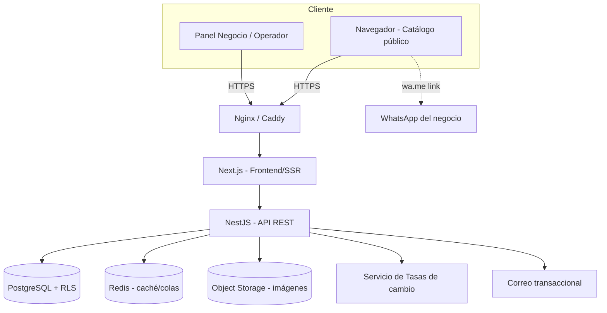
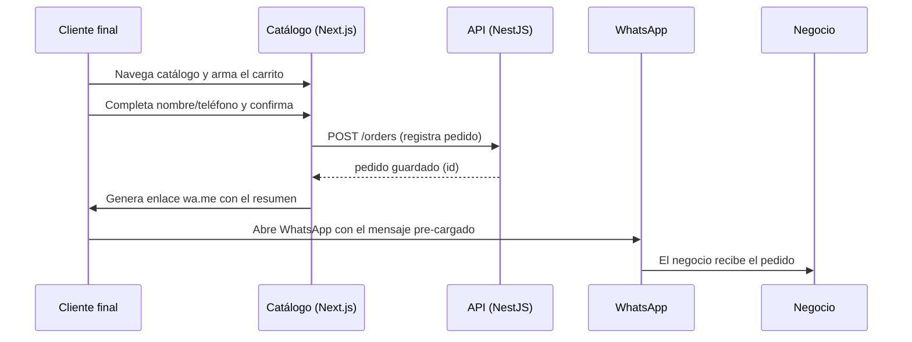
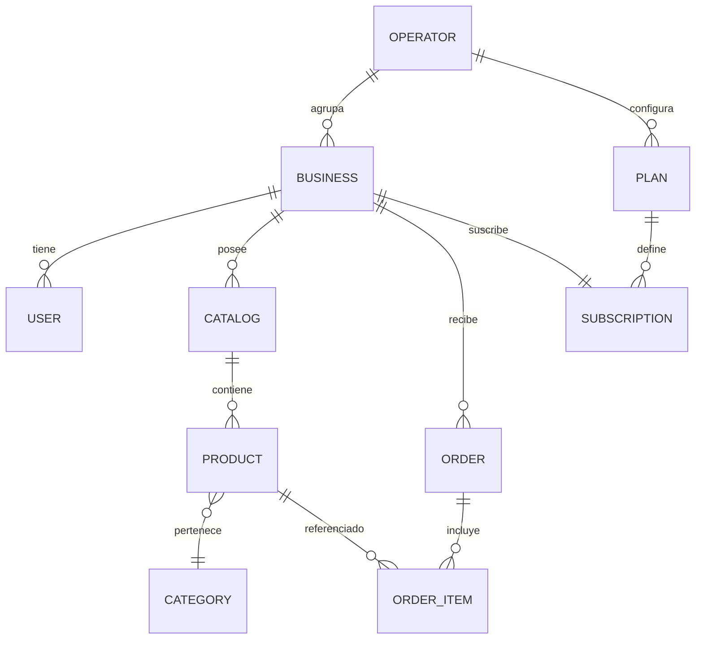
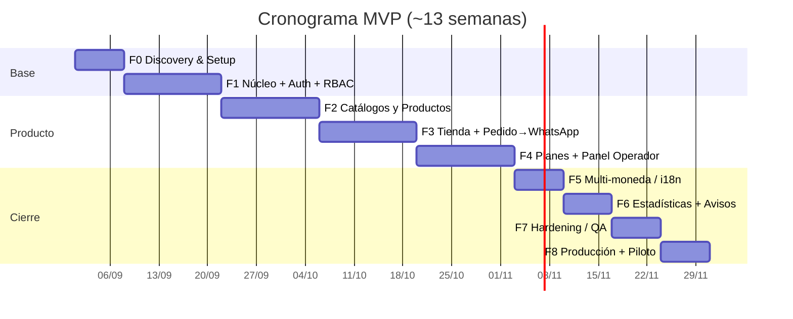

# Plan de Desarrollo — Plataforma de Catálogos + WhatsApp (SaaS multi-tenant)

> **Modelo:** Opción 2 — Licencia / Alquiler. La plataforma es **propiedad del desarrollador**
> y se **alquila por suscripción** al cliente operador.
> **Documento maestro de planificación.** A leer y aprobar **antes** de escribir código.

| Campo | Valor |
|---|---|
| **Nombre en clave** | `Catálogo+WA` (nombre comercial por definir) |
| **Versión del documento** | 1.0 |
| **Fecha** | 2026-08-21 |
| **Autor / Propietario del software** | Moisés (desarrollador — retiene la propiedad intelectual) |
| **Cliente operador** | Cliente C (alquila la plataforma, la opera bajo su marca) |
| **Estado** | Planificación (pre-desarrollo) |
| **Rol asumido en este documento** | DevOps + Gestión de Proyecto |

---

## Tabla de contenido

1. [Resumen ejecutivo](#1-resumen-ejecutivo)
2. [Descripción del proyecto](#2-descripción-del-proyecto)
3. [Modelo de negocio y licenciamiento (Opción 2)](#3-modelo-de-negocio-y-licenciamiento-opción-2)
4. [Actores y roles](#4-actores-y-roles)
5. [Alcance (scope) y límites](#5-alcance-scope-y-límites)
6. [Requerimientos funcionales](#6-requerimientos-funcionales)
7. [Requerimientos no funcionales](#7-requerimientos-no-funcionales)
8. [Arquitectura técnica](#8-arquitectura-técnica)
9. [Modelo de datos](#9-modelo-de-datos)
10. [Integraciones externas](#10-integraciones-externas)
11. [DevOps, entornos e infraestructura](#11-devops-entornos-e-infraestructura)
12. [Seguridad y cumplimiento](#12-seguridad-y-cumplimiento)
13. [Roadmap por fases](#13-roadmap-por-fases)
14. [Cronograma (Gantt)](#14-cronograma-gantt)
15. [Equipo y roles del proyecto](#15-equipo-y-roles-del-proyecto)
16. [Gestión de riesgos](#16-gestión-de-riesgos)
17. [Presupuesto y costos operativos](#17-presupuesto-y-costos-operativos)
18. [KPIs y métricas de éxito](#18-kpis-y-métricas-de-éxito)
19. [Definición de Hecho (DoD) y criterios de aceptación](#19-definición-de-hecho-dod-y-criterios-de-aceptación)
20. [Soporte, mantenimiento y SLA](#20-soporte-mantenimiento-y-sla)
21. [Próximos pasos](#21-próximos-pasos)
22. [Glosario](#22-glosario)

---

## 1. Resumen ejecutivo

**Qué es:** una plataforma web **multi-tenant** que permite a distintos negocios digitalizar
sus catálogos de productos, gestionarlos, recibir pedidos de sus clientes y **derivar cada
pedido a WhatsApp** para cerrar la venta. Reemplaza los catálogos hechos a mano o impresos.

**Para quién:** negocios (comercios) que hoy manejan catálogos manuales y quieren vender de
forma más ágil, sin construir su propia app.

**Modelo comercial (Opción 2):** el desarrollador construye y **es dueño** de la plataforma;
el **cliente operador** (Cliente C) la **alquila** (~USD 250/mes, sin pago inicial), la opera
bajo su marca y **revende suscripciones** a los negocios mediante planes **Básico / Medio /
Premium**. La plataforma incluye hosting, mantenimiento, actualizaciones y soporte.

**Objetivo del MVP:** salir a producción con el flujo completo *(negocio → catálogo → cliente
final → pedido → WhatsApp)* y el sistema de planes/límites, con **costo de infraestructura
bajo** (~USD 25–55/mes) para mantener margen sano dentro del alquiler.

**Estimación MVP:** ~**13 semanas** (equipo pequeño). Ver [Roadmap](#13-roadmap-por-fases).

**Ventaja estratégica:** como la plataforma es un **activo propio**, una vez construida puede
alquilarse a **más operadores**, no solo a Cliente C. El costo de desarrollo se amortiza y
cada nuevo alquiler es margen.

---

## 2. Descripción del proyecto

### 2.1 Problema
Muchos negocios llevan su catálogo **a mano o impreso**: difícil de actualizar, sin
control de inventario ni de precios, sin forma ágil de tomar pedidos. La venta termina
ocurriendo por WhatsApp de forma desordenada (fotos sueltas, listas por texto).

### 2.2 Solución
Una plataforma donde:
1. El **negocio** crea su cuenta y sube su **catálogo de productos** (con fotos, precios, stock).
2. **Gestiona** uno o varios catálogos desde un panel.
3. Sus **clientes** navegan el catálogo público y **arman un pedido** (carrito).
4. La plataforma **genera el pedido/resumen y lo envía a WhatsApp** del negocio (o del cliente).
5. El negocio confirma y despacha.

### 2.3 Propuesta de valor
- **Para el negocio:** catálogo digital profesional en minutos, pedidos ordenados, menos fricción.
- **Para el operador (Cliente C):** un producto SaaS listo para revender por suscripción, sin
  costos de desarrollo ni equipo técnico.
- **Para el desarrollador (dueño):** un activo recurrente y reutilizable.

### 2.4 Decisión clave de diseño para el MVP
> **El pedido se envía a WhatsApp mediante enlace `wa.me` con mensaje pre-formateado (gratis),
> no mediante la API oficial de WhatsApp en el MVP.** Esto evita los costos por conversación de
> la WhatsApp Cloud API y mantiene el modelo de USD 250/mes rentable. La **Cloud API oficial**
> (mensajes automáticos, confirmaciones, notificaciones) queda como mejora de una fase futura.

---

## 3. Modelo de negocio y licenciamiento (Opción 2)

- **Propiedad:** el código y la IP son del **desarrollador**. El cliente **no compra** el software.
- **Alquiler:** el cliente operador paga **~USD 250/mes** (sin pago inicial). Incluye hosting,
  mantenimiento, actualizaciones y soporte.
- **Reventa:** el operador vende a sus negocios los planes **Básico / Medio / Premium**.
- **Rescisión:** contrato mensual, sin permanencia. Al terminar, cesa el acceso; los **datos del
  operador se exportan** y se conservan X días antes de purgarse (definir en contrato).
- **Marca:** la plataforma se presenta con la marca del operador (logo, colores, dominio) — modelo
  *white-label ligero*.

### 3.1 Planes que el operador vende a los negocios (ejemplo configurable)

| Característica | Básico | Medio | Premium |
|---|---|---|---|
| Catálogos | 1 | 5 | Ilimitado |
| Productos | 50 | 500 | Ilimitado |
| Pedidos / mes | 100 | 1.000 | Ilimitado |
| Usuarios del negocio | 1 | 3 | 10 |
| Multi-moneda internacional | — | ✓ | ✓ |
| Dominio propio | — | — | ✓ |
| Estadísticas | Básicas | Avanzadas | Avanzadas + exportación |
| Soporte | Correo | Correo / Chat | Prioritario |

> Los límites son **parametrizables** por plan desde el panel del operador; la tabla es un punto
> de partida a validar comercialmente.

---

## 4. Actores y roles

| Rol | Quién | Qué hace |
|---|---|---|
| **Super Admin (Owner)** | Desarrollador / dueño | Administra toda la plataforma, operadores, versiones, infraestructura. |
| **Operador (Tenant raíz)** | Cliente C | Administra negocios, define planes y precios, factura, ve métricas globales, personaliza marca. |
| **Negocio (Comercio)** | Sus clientes | Gestiona sus catálogos, productos, pedidos y su suscripción. |
| **Usuario del negocio** | Empleados del comercio | Cargan productos, atienden pedidos (según permisos). |
| **Cliente final (Comprador)** | Público | Navega catálogo, arma pedido, lo envía a WhatsApp. Sin cuenta obligatoria en MVP. |

> **Multi-tenant:** cada **negocio** es un *tenant* aislado (sus datos no se mezclan con otros).
> El **operador** es el tenant raíz que agrupa a todos sus negocios.

---

## 5. Alcance (scope) y límites

### 5.1 Dentro del MVP (In scope) ✅
- Registro/login y gestión de cuentas (operador, negocio, usuarios).
- Panel del **operador**: alta de negocios, gestión de planes y límites, marca, métricas globales.
- Panel del **negocio**: gestión de catálogos, productos (foto, precio, stock, categorías), su suscripción.
- **Catálogo público** por negocio (URL propia tipo `operador.com/negocio`).
- **Carrito y armado de pedido** por el cliente final.
- **Envío del pedido a WhatsApp** vía `wa.me` con mensaje pre-formateado.
- **Planes y límites** (Básico/Medio/Premium) con aplicación de topes.
- **Multi-moneda** con conversión automática (una moneda base + tasas por país).
- **Estadísticas básicas** (pedidos, productos más pedidos, ingresos estimados).
- **Multi-idioma** base (español; arquitectura lista para más idiomas).
- Panel de **Super Admin** mínimo (gestión de operadores y estado del sistema).

### 5.2 Fuera del MVP — Límites explícitos (Out of scope) 🚫
- **Pasarela de pago en línea automática** (cobros con tarjeta). El MVP no procesa pagos: el
  pedido se cierra por WhatsApp y el cobro es acordado entre negocio y cliente. *(Fase futura.)*
- **App móvil nativa (Flutter Android/iOS).** El MVP es **web responsive**. *(Fase futura.)*
- **WhatsApp Cloud API oficial** (mensajes automáticos/salientes, chatbot). *(Fase futura.)*
- **Facturación fiscal/electrónica** (integración con SENIAT u organismos). *(Fase futura.)*
- **Logística/envíos** (tarifas, tracking, integración con couriers). *(Fuera.)*
- **Marketplace** (varios negocios en un mismo carrito). *(Fuera.)*
- **Inventario avanzado** (variantes complejas, almacenes múltiples, órdenes de compra). *(Fuera del MVP.)*
- **Integraciones contables/ERP.** *(Fuera.)*
- Personalización a medida por negocio individual fuera de la marca del operador. *(Fuera.)*

### 5.3 Supuestos
- El operador aporta su **número de WhatsApp** (o el de cada negocio) para recibir pedidos.
- Las **tasas de cambio** se toman de una fuente pública/API (ej. proveedor de tasas + tasa BCV
  para Venezuela); no se garantiza exactitud transaccional en el MVP (son referenciales).
- El volumen inicial es **bajo-medio** (decenas de negocios, cientos–miles de pedidos/mes),
  compatible con una infraestructura de un solo servidor.
- El contenido (fotos/textos) es responsabilidad de cada negocio.

### 5.4 Restricciones
- **Presupuesto de infraestructura:** debe mantenerse **≤ ~USD 75/mes** para preservar el margen
  del alquiler de USD 250/mes.
- **Tiempo:** MVP en ~13 semanas con equipo pequeño.
- **Legal:** el software permanece como propiedad del desarrollador (licencia de uso, no venta).

---

## 6. Requerimientos funcionales

Codificados como `RF-xx`. Prioridad: **M** (must / MVP), **S** (should), **C** (could / futuro).

### 6.1 Cuentas y acceso
- **RF-01 (M):** Registro e inicio de sesión con correo y contraseña; recuperación de contraseña.
- **RF-02 (M):** Roles y permisos (RBAC): Super Admin, Operador, Negocio, Usuario de negocio.
- **RF-03 (M):** Invitación de usuarios a un negocio con rol asignado.
- **RF-04 (S):** Verificación de correo y sesión persistente segura.

### 6.2 Operador (tenant raíz)
- **RF-05 (M):** Alta/baja/edición de negocios (tenants).
- **RF-06 (M):** Definición de planes (Básico/Medio/Premium) con sus límites y precios.
- **RF-07 (M):** Asignación/cambio de plan a un negocio.
- **RF-08 (M):** Personalización de marca (logo, colores, nombre, dominio/subdominio).
- **RF-09 (S):** Métricas globales (negocios activos, pedidos totales, ingresos por suscripción).
- **RF-10 (C):** Gestión de cobros de suscripción a los negocios (manual en MVP; automático futuro).

### 6.3 Negocio
- **RF-11 (M):** Crear y gestionar **catálogos** (según límite del plan).
- **RF-12 (M):** CRUD de **productos**: nombre, descripción, precio, moneda base, stock, categoría, ≥1 imagen.
- **RF-13 (M):** Organización por **categorías**.
- **RF-14 (M):** Activar/desactivar productos y catálogos (borrador/publicado).
- **RF-15 (S):** Carga masiva de productos (CSV) y gestión de imágenes.
- **RF-16 (M):** Ver y gestionar **pedidos recibidos** (estado: nuevo, atendido, cerrado).
- **RF-17 (M):** Configurar el **número de WhatsApp** de destino de los pedidos.

### 6.4 Catálogo público y pedido
- **RF-18 (M):** Página pública del catálogo por negocio, **responsive**, con buscador y categorías.
- **RF-19 (M):** **Carrito**: agregar/quitar productos, cantidades, subtotal.
- **RF-20 (M):** Datos mínimos del comprador (nombre, teléfono) y nota opcional.
- **RF-21 (M):** Generar **resumen del pedido** y **enviarlo a WhatsApp** (`wa.me`) con el detalle formateado.
- **RF-22 (M):** Registrar el pedido en la plataforma (para métricas y seguimiento).

### 6.5 Multi-moneda / internacional
- **RF-23 (M):** Producto con **moneda base**; el catálogo muestra el precio en la **moneda del visitante**.
- **RF-24 (M):** Conversión automática según **tasa vigente** (fuente configurable; BCV para Venezuela).
- **RF-25 (S):** El visitante puede **elegir manualmente** su moneda.
- **RF-26 (S):** Formato regional de números/moneda (locale).

### 6.6 Planes y límites
- **RF-27 (M):** Aplicar topes del plan (catálogos, productos, pedidos/mes, usuarios).
- **RF-28 (M):** Bloquear/avisar al alcanzar el límite y sugerir upgrade.
- **RF-29 (S):** Historial de plan y cambios.

### 6.7 Estadísticas
- **RF-30 (M):** Panel de negocio: pedidos por período, productos más pedidos, ingreso estimado.
- **RF-31 (S):** Exportación (CSV) — solo Premium.

---

## 7. Requerimientos no funcionales

| Código | Categoría | Requisito |
|---|---|---|
| **RNF-01** | Rendimiento | Carga del catálogo público < 2,5 s (P75) en 4G; imágenes optimizadas (lazy + CDN/caché). |
| **RNF-02** | Disponibilidad | Objetivo 99% mensual en MVP (ver [SLA](#20-soporte-mantenimiento-y-sla)). |
| **RNF-03** | Escalabilidad | Arquitectura lista para pasar de 1 servidor a servicios gestionados sin reescribir. |
| **RNF-04** | Seguridad | Cifrado en tránsito (HTTPS/TLS), hashing de contraseñas (bcrypt/argon2), aislamiento de tenants. |
| **RNF-05** | Multi-tenant | Aislamiento lógico por `tenant_id` + **Row-Level Security** en PostgreSQL. |
| **RNF-06** | i18n / L10n | Textos externalizados; soporte multi-idioma y multi-moneda desde el diseño. |
| **RNF-07** | Observabilidad | Logs centralizados, métricas y alertas básicas (errores, caídas, uso de recursos). |
| **RNF-08** | Respaldos | Backups automáticos diarios de BD + almacenamiento; retención ≥ 7 días; restauración probada. |
| **RNF-09** | Mantenibilidad | Código tipado (TypeScript), pruebas automatizadas, CI, documentación técnica. |
| **RNF-10** | Portabilidad | Todo contenedorizado (Docker) para reproducibilidad y migración de proveedor. |
| **RNF-11** | Accesibilidad | Contraste, navegación por teclado y etiquetas ARIA en el catálogo público. |
| **RNF-12** | Costo | Infra ≤ ~USD 75/mes durante el MVP. |

---

## 8. Arquitectura técnica

### 8.1 Stack propuesto (lean, contenedorizado)

| Capa | Tecnología | Motivo |
|---|---|---|
| Frontend | **React + Next.js (TypeScript)** | SSR/SEO para catálogos públicos, DX, un solo lenguaje. |
| Backend/API | **Node.js + NestJS (TypeScript)** | Estructurado, modular, RBAC y multi-tenant claros. |
| Base de datos | **PostgreSQL** (con RLS) | Relacional robusto, aislamiento por tenant, JSON cuando haga falta. |
| Caché / colas | **Redis** | Sesiones, caché de tasas de cambio, cola de tareas (envíos, thumbnails). |
| Almacenamiento | **Object storage S3-compatible** (Cloudflare R2 / Backblaze) | Imágenes baratas + CDN. |
| Proxy / TLS | **Nginx / Caddy** | Reverse proxy, HTTPS automático, dominios de operador. |
| Contenedores | **Docker + Docker Compose** | Reproducible; base para escalar a orquestación futura. |
| CI/CD | **GitHub Actions** | Build, test y deploy automáticos. |
| Correo | **Resend / SMTP** (free tier) | Verificación y notificaciones. |

> **Nota de propiedad:** todo el stack es open-source o de bajo costo; nada ata la IP a un
> proveedor. El uso de **Azure** (u otro cloud) es opcional para escalar; el MVP puede vivir en un
> **VPS económico**.

### 8.2 Diagrama de componentes

### 8.3 Flujo del pedido → WhatsApp

### 8.4 Estrategia multi-tenant
- Un esquema compartido con columna `tenant_id` en cada tabla + **Row-Level Security** de
  PostgreSQL: cada consulta queda filtrada por el tenant del usuario autenticado.
- El **operador** es el tenant raíz; los **negocios** son sub-tenants agrupados bajo él.
- Enrutamiento por **subdominio/dominio** (`negocio.operador.com` o dominio propio en Premium).

---

## 9. Modelo de datos

Entidades principales (simplificado):

| Entidad | Campos clave |
|---|---|
| **Operator** | id, nombre, marca (logo/colores), dominio, config_monedas, estado |
| **Business** | id, operator_id, nombre, slug, whatsapp, moneda_base, estado |
| **User** | id, business_id/operator_id, email, hash_password, rol |
| **Plan** | id, operator_id, nombre, límites (jsonb), precio |
| **Subscription** | id, business_id, plan_id, estado, periodo, uso_actual |
| **Catalog** | id, business_id, nombre, estado (borrador/publicado) |
| **Category** | id, catalog_id, nombre, orden |
| **Product** | id, catalog_id, category_id, nombre, desc, precio, moneda, stock, imagenes[], activo |
| **Order** | id, business_id, cliente_nombre, cliente_tel, total, moneda, estado, created_at |
| **OrderItem** | id, order_id, product_id, cantidad, precio_unit |
| **FxRate** | moneda, valor_en_base, fuente, fecha |

---

## 10. Integraciones externas

| Integración | Uso | MVP | Notas |
|---|---|---|---|
| **WhatsApp `wa.me`** | Enviar pedido al negocio | ✅ | Gratis; enlace con mensaje pre-formateado. |
| **WhatsApp Cloud API (Meta)** | Mensajes/confirmaciones automáticas | ❌ (futuro) | Tiene costo por conversación; requiere verificación de negocio. |
| **Proveedor de tasas de cambio** | Multi-moneda | ✅ | API pública de tasas + **tasa BCV** para Venezuela; caché en Redis. |
| **Object storage (S3/R2)** | Imágenes de productos | ✅ | Barato + CDN. |
| **Correo transaccional** | Verificación, avisos | ✅ | Free tier. |
| **Pasarela de pago** | Cobro de suscripciones / pedidos | ❌ (futuro) | Definir según país; en MVP cobro manual/acordado. |

---

## 11. DevOps, entornos e infraestructura

### 11.1 Entornos
| Entorno | Propósito | Datos |
|---|---|---|
| **Local (dev)** | Desarrollo | Docker Compose; datos de prueba. |
| **Staging** | Pruebas/QA/demo al operador | Réplica de prod; datos ficticios. |
| **Producción** | Operación real | Datos reales; backups; monitoreo. |

### 11.2 Estrategia de ramas (Git)
- `main` → producción (protegida, solo por PR + CI verde).
- `develop` → integración → despliega a **staging**.
- `feature/*`, `fix/*` → PR hacia `develop`.
- Versionado semántico y `CHANGELOG.md`.

### 11.3 CI/CD (GitHub Actions)
1. **CI en cada PR:** lint, typecheck, pruebas unitarias/integración, build de imágenes Docker.
2. **CD a staging:** al fusionar en `develop`, deploy automático a staging.
3. **CD a producción:** al fusionar en `main` (o tag `vX.Y.Z`), deploy con **migraciones de BD**
   controladas y opción de **rollback**.
4. **Escaneo de seguridad:** dependencias (npm audit) y secretos.

### 11.4 Infraestructura (MVP, lean)
- **1 VPS** (2 vCPU / 4 GB) con **Docker Compose**: Nginx/Caddy + Next.js + NestJS + PostgreSQL + Redis.
- Imágenes en **object storage** con CDN.
- **HTTPS automático** (Caddy/Let's Encrypt), incluidos dominios de operadores.
- **Backups diarios** de BD + almacenamiento; retención ≥ 7 días; restauración probada trimestralmente.
- **Observabilidad:** logs centralizados + métricas de sistema + alertas (uptime, errores, disco/CPU).
- **Secrets:** variables gestionadas fuera del repo (GitHub Secrets / `.env` cifrado); **nunca** claves en código.
- **IaC ligero:** todo el arranque descrito en `docker-compose.yml` + scripts, para reproducir/migrar de proveedor.

> **Ruta de escalado:** cuando el volumen lo exija → BD gestionada, réplicas del backend detrás de
> balanceador y almacenamiento/CDN dedicados. La contenedorización lo hace sin reescritura.

---

## 12. Seguridad y cumplimiento

- **Autenticación:** contraseñas con **argon2/bcrypt**; tokens de sesión seguros; expiración/rotación.
- **Autorización:** **RBAC** por rol y **aislamiento por tenant** (RLS en PostgreSQL).
- **Transporte:** HTTPS/TLS en todo; HSTS.
- **Entradas:** validación y saneo (evitar inyección/XSS); límites de tamaño de imágenes.
- **Rate limiting** y protección básica anti-abuso en endpoints públicos.
- **Datos personales:** se recolectan datos mínimos del comprador (nombre/teléfono). Definir
  **política de privacidad** y retención; consentimiento en el formulario de pedido.
- **Respaldos y recuperación:** backups cifrados; plan de recuperación (RTO/RPO objetivo definidos).
- **Gestión de accesos:** principio de mínimo privilegio; auditoría de acciones sensibles.
- **Propiedad:** cláusula de licencia de uso (no venta); los datos del operador son suyos y exportables.

---

## 13. Roadmap por fases

> Estimación con **equipo pequeño**. Cada fase termina con incremento **demostrable** en staging.

| Fase | Nombre | Duración | Entregables principales |
|---|---|---|---|
| **F0** | Discovery & Setup | 1 sem | Requisitos finos, wireframes, repos, CI/CD, entornos, `docker-compose`, esqueleto multi-tenant. |
| **F1** | Núcleo + Auth + RBAC | 2 sem | Registro/login, roles, multi-tenant con RLS, panel base. |
| **F2** | Catálogos y Productos | 2 sem | CRUD de catálogos/productos/categorías, carga de imágenes, borrador/publicado. |
| **F3** | Tienda pública + Pedido→WhatsApp | 2 sem | Catálogo público responsive, carrito, resumen y envío `wa.me`, registro de pedidos. |
| **F4** | Planes, Límites y Panel Operador | 2 sem | Planes Básico/Medio/Premium, aplicación de topes, alta de negocios, marca, métricas globales. |
| **F5** | Multi-moneda / i18n | 1 sem | Moneda base + conversión automática (BCV y otras), selector de moneda, formatos regionales. |
| **F6** | Estadísticas + Notificaciones | 1 sem | Panel de métricas del negocio, avisos por correo, exportación (Premium). |
| **F7** | Hardening / QA / Seguridad / Performance | 1 sem | Pruebas, optimización, auditoría de seguridad, tuning de rendimiento. |
| **F8** | Deploy Producción + Piloto + Capacitación | 1 sem | Puesta en producción, piloto con negocios reales, capacitación al operador, documentación. |

**Total MVP: ~13 semanas.**

### Fase futura (post-MVP, backlog priorizado)
1. **App móvil (Flutter, Android/iOS)** — reutiliza la misma API.
2. **WhatsApp Cloud API oficial** — confirmaciones y notificaciones automáticas.
3. **Pasarela de pago** — cobro de suscripciones y/o de pedidos.
4. **Facturación fiscal / electrónica**.
5. **Inventario avanzado y variantes**.
6. **Panel de analítica avanzada** para el operador.

---

## 14. Cronograma (Gantt)

> Fecha de inicio tentativa **2026-09-01** (ajustar tras aprobación). Fin estimado ~fin de noviembre 2026.

---

## 15. Equipo y roles del proyecto

| Rol | Responsabilidad | Nota |
|---|---|---|
| **Project Manager / Product Owner** | Prioriza backlog, aprueba entregables, interlocución con el operador. | Puede recaer en el desarrollador líder. |
| **DevOps** | Entornos, CI/CD, infraestructura, backups, monitoreo, seguridad operativa. | Documento asumido bajo este rol. |
| **Backend** | API NestJS, modelo de datos, multi-tenant, integraciones. | |
| **Frontend** | Next.js, catálogo público, paneles, i18n/multi-moneda. | |
| **QA** | Casos de prueba, pruebas manuales/automatizadas, criterios de aceptación. | Puede compartirse. |
| **Diseño UI/UX** | Wireframes, sistema visual, accesibilidad. | Reutilizar el sistema visual ya definido (índigo/Inter). |

> Con un equipo reducido, varios roles se combinan. Definir asignación real en F0.

**Cadencia:** sprints de **1 semana**, con demo y retro al cierre; tablero Kanban (To do / Doing / Review / Done).

---

## 16. Gestión de riesgos

| # | Riesgo | Prob. | Impacto | Mitigación |
|---|---|---|---|---|
| R1 | Costos de WhatsApp Cloud API rompen el margen | Media | Alto | MVP con `wa.me` gratis; Cloud API solo como upsell futuro medido. |
| R2 | Volatilidad/precisión de tasas de cambio (Venezuela) | Alta | Medio | Tasas referenciales con aviso; caché y fuente configurable (BCV); recalcular al confirmar. |
| R3 | Aislamiento multi-tenant defectuoso (fuga entre negocios) | Baja | Muy alto | RLS en PostgreSQL + pruebas de aislamiento automatizadas obligatorias. |
| R4 | Alcance creciente (scope creep) | Alta | Alto | Límites explícitos (§5.2); cambios via control de cambios y repriorización. |
| R5 | Costo de infraestructura sube con el crecimiento | Media | Medio | Arquitectura lean y escalable por pasos; monitoreo de costos. |
| R6 | Dependencia de un único proveedor de hosting | Baja | Medio | Todo dockerizado + IaC → migración reproducible. |
| R7 | Contenido/imágenes pesadas degradan rendimiento | Media | Medio | Optimización/compresión de imágenes, CDN, lazy loading. |
| R8 | Rotación/indisponibilidad del equipo reducido | Media | Alto | Documentación, código tipado y probado, bus factor reducido con onboarding claro. |
| R9 | Cumplimiento de datos personales | Media | Medio | Política de privacidad, datos mínimos, retención definida. |

---

## 17. Presupuesto y costos operativos

### 17.1 Infraestructura mensual objetivo (producción MVP)

| Recurso | Opción recomendada | Costo aprox./mes (USD) |
|---|---|---|
| VPS (app + Docker) | Hetzner CPX21 / DigitalOcean 4 GB | 12 – 24 |
| Base de datos | PostgreSQL en el VPS (MVP) o gestionada básica | 0 – 15 |
| Almacenamiento + CDN | Cloudflare R2 / Backblaze B2 | 0 – 6 |
| Dominio | prorrateo anual | ~1,5 |
| Backups | snapshots/retención | 2 – 5 |
| Correo transaccional | free tier | 0 |
| WhatsApp (`wa.me`) | gratis | 0 |
| Monitoreo/alertas | free/low tier | 0 – 4 |
| **Total estimado** | | **~25 – 55 / mes** |

> **Margen:** con alquiler de **USD 250/mes** e infra **~USD 25–55/mes**, el margen operativo bruto
> ronda **USD 195–225/mes por operador** (antes de tu tiempo de soporte/mantenimiento). Reutilizar
> la plataforma con más operadores mejora el retorno del desarrollo.

### 17.2 Costo de desarrollo
El desarrollo del MVP es la **inversión del dueño** (activo propio), no se le cobra al operador
como setup en la Opción 2 (recordar: ~USD 250/mes, sin pago inicial). Estimar según horas del
equipo × tarifa interna en F0.

---

## 18. KPIs y métricas de éxito

**Técnicos**
- Disponibilidad ≥ 99% mensual.
- Tiempo de carga del catálogo < 2,5 s (P75).
- Tasa de errores 5xx < 1%.
- Cobertura de pruebas en módulos críticos (auth, multi-tenant, pedidos) ≥ 70%.

**Producto / Negocio**
- Nº de negocios activos por operador.
- Nº de pedidos generados / mes.
- Tasa de conversión carrito → pedido enviado a WhatsApp.
- Retención mensual de negocios (churn bajo).
- Tiempo desde alta de negocio hasta primer catálogo publicado (onboarding).

---

## 19. Definición de Hecho (DoD) y criterios de aceptación

Una funcionalidad está **"Hecha"** cuando:
- [ ] Cumple sus criterios de aceptación (casos de prueba) acordados.
- [ ] Tiene pruebas automatizadas que pasan en CI.
- [ ] Pasa lint + typecheck + build sin errores.
- [ ] Revisada por PR (code review) y fusionada sin conflictos.
- [ ] Desplegada y verificada en **staging**.
- [ ] Documentada (API/uso) y con textos i18n externalizados.
- [ ] Respeta aislamiento multi-tenant y controles de seguridad.

**Criterios de aceptación del MVP (alto nivel):**
- [ ] Un operador da de alta un negocio y le asigna un plan.
- [ ] El negocio crea un catálogo y publica productos con imagen y precio.
- [ ] Un cliente final arma un pedido y lo envía correctamente a WhatsApp.
- [ ] Los límites del plan se aplican (no exceder catálogos/productos/pedidos).
- [ ] El catálogo muestra precios en la moneda del visitante.
- [ ] La marca del operador se refleja (logo/colores/dominio).
- [ ] Backups diarios funcionando y restauración probada.

---

## 20. Soporte, mantenimiento y SLA

Como el modelo es **alquiler**, el mantenimiento es parte del servicio:

| Aspecto | Compromiso MVP |
|---|---|
| **Disponibilidad** | Objetivo 99% mensual. |
| **Soporte** | Correo/chat en horario hábil (L–V); tiempos de respuesta por severidad. |
| **Severidades** | S1 caída total: respuesta < 4 h · S2 funcional mayor: < 1 día hábil · S3 menor: < 3 días hábiles. |
| **Actualizaciones** | Correctivas continuas; evolutivas según roadmap; ventanas de mantenimiento avisadas. |
| **Backups** | Diarios, retención ≥ 7 días, restauración probada. |
| **Continuidad** | Si el operador termina el contrato: exportación de sus datos + purga tras X días. |

> Los valores exactos (horarios, tiempos, retención) se **formalizan en el contrato de servicio**.

---

## 21. Próximos pasos

1. **Aprobar este documento** (alcance, límites y roadmap) con el operador.
2. **F0 – Discovery (semana 1):**
   - Definir nombre comercial y marca del operador.
   - Cerrar wireframes y validar los límites de los planes.
   - Crear repositorios, CI/CD y entornos (dev/staging/prod).
   - Definir fuente(s) de tasas de cambio y número(s) de WhatsApp.
3. **Firmar** el acuerdo de licencia/alquiler y el SLA.
4. **Arrancar F1** (núcleo multi-tenant + auth).

---

## 22. Glosario

- **SaaS:** software como servicio, entregado por suscripción.
- **Multi-tenant:** una sola plataforma sirve a múltiples clientes (tenants) con datos aislados.
- **Tenant:** cliente/negocio aislado dentro de la plataforma.
- **Operador:** el cliente que alquila la plataforma y la opera bajo su marca (Cliente C).
- **RLS (Row-Level Security):** filtrado de filas por tenant a nivel de base de datos.
- **RBAC:** control de acceso basado en roles.
- **`wa.me`:** enlace de WhatsApp con mensaje pre-formateado (sin costo de API).
- **Cloud API (WhatsApp):** API oficial de Meta para mensajería (con costo por conversación).
- **CI/CD:** integración y despliegue continuos.
- **IaC:** infraestructura como código.
- **SLA:** acuerdo de nivel de servicio.
- **DoD:** definición de "hecho".
- **RTO/RPO:** objetivos de tiempo y punto de recuperación ante incidentes.

---

*Documento de planificación v1.0 — sujeto a validación en F0. La plataforma es propiedad del
desarrollador; el presente plan corresponde al modelo de alquiler por suscripción (Opción 2).*
