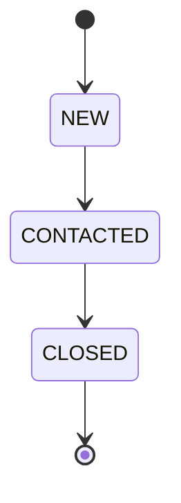
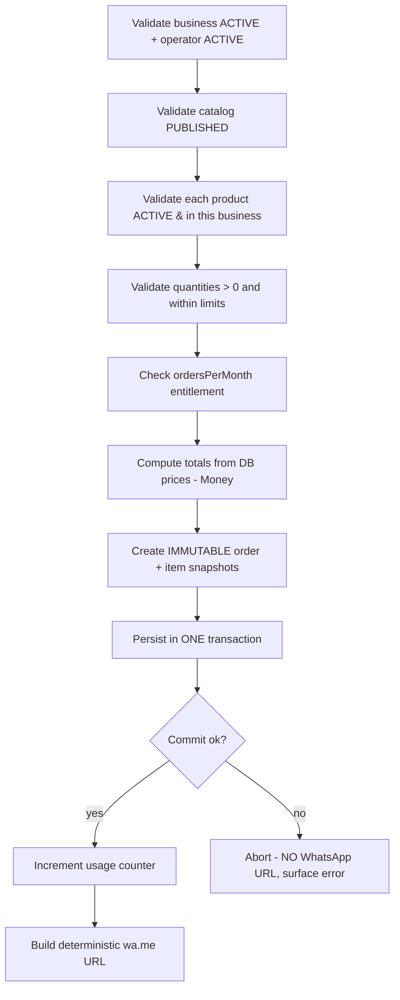

# Domain Model: Vitrina

- **Status:** Proposed (Phase 0) — awaiting Director approval
- Modeled from the **domain**, not from UI screens (per directive §7).

## 1. Aggregates & ownership

An **aggregate** is a consistency boundary; it is loaded/saved as a unit and enforces its invariants.

| Aggregate | Root | Owns | Referenced by id (not owned) |
|---|---|---|---|
| **Operator** | Operator | Branding, operator settings | — |
| **Plan** | Plan | Feature/limit definition (value object) | Operator (owner) |
| **Business** | Business | WhatsApp config, base currency | Operator |
| **Subscription** | Subscription | Current plan ref, usage counters | Business, Plan |
| **Catalog** | Catalog | Categories, publication state | Business |
| **Product** | Product | Product images, price, stock, state | Catalog, Business, Category |
| **Order** | Order | Order items (**immutable snapshot**), state | Business (+ product ids for reference only) |
| **User / Membership** | User | Credentials | Operator/Business via Membership |
| **ExchangeRate** | ExchangeRate | rate value, source, timestamp | Currency pair |

> Note: `Product` images are part of the Product aggregate for consistency; large binaries live in object storage (ADR-0004), the aggregate holds references.

## 2. Entities & value objects

**Value objects (immutable, no identity):**
- `Money { amountMinor: bigint, currency }` — ADR-0003.
- `PlanLimits { catalogs, products, ordersPerMonth, users, features:{ multiCurrency, export, customDomain, ... } }` — numeric limits use a sentinel for **unlimited**.
- `Branding { logoRef, primaryColor, name, domain? }`.
- `WhatsAppTarget { e164Phone }` — validated E.164.
- `Slug` — URL-safe, unique per parent scope.
- `TenantContext { operatorId, businessId?, role }` — request-scoped (ADR-0002).

**Entities (identity + lifecycle):** Operator, Plan, Business, Subscription, Catalog, Category, Product, ProductImage, Order, OrderItem, User, Membership, ExchangeRate.

## 3. Lifecycle states

### Operator
`ACTIVE → SUSPENDED → ACTIVE` (reversible). A `SUSPENDED` operator serves **no** public catalogs and its businesses cannot be operated.

### Business
`DRAFT → ACTIVE → SUSPENDED → ARCHIVED`.
- `DRAFT`: created, not yet serving public.
- `ACTIVE`: may publish catalogs and receive orders (subject to plan + operator status).
- `SUSPENDED`: public hidden, admin read-only.
- `ARCHIVED`: soft-retired; data retained per policy.

### Catalog
`DRAFT ⇄ PUBLISHED → ARCHIVED`. Only `PUBLISHED` catalogs of an `ACTIVE` business under an `ACTIVE` operator are publicly visible.

### Product
`DRAFT ⇄ ACTIVE → ARCHIVED` (+ `stock: outOfStock` flag, not a lifecycle state). Archived products remain referenceable by historical orders.

### Subscription
`ACTIVE → PAST_DUE? → CANCELLED` — for MVP (no online payments) transitions are **operator-driven** (manual). `PAST_DUE`/dunning are **deferred** until billing exists.

### Order — state machine (directive §10)

- **MVP states:** `NEW → CONTACTED → CLOSED`.
- `CANCELLED` / `EXPIRED`: **evaluated and deferred** — no real MVP use case yet (no payment/hold to expire, no automated cancellation). Add only when a concrete trigger exists (directive: don't add states without a use case).
- Transitions are business-user actions, forward-only for MVP (no arbitrary edits). The **price snapshot never changes** across transitions.

## 4. Invariants (documented — enforced server-side + tests)

| ID | Invariant | Enforced where |
|---|---|---|
| INV-1 | A product belongs only to a catalog of **its own** business. | FK + RLS + service check (create/move product). |
| INV-2 | A business cannot exceed its plan limits (catalogs, products, orders/month, users). | `entitlements` module at write time (P3). |
| INV-3 | An **inactive/draft/suspended** business publishes no public catalog. | Public read path predicate + business-status check. |
| INV-4 | A **suspended operator** serves no active public catalogs. | Public read path predicate + operator-status check. |
| INV-5 | An order price snapshot is **immutable** after creation. | Snapshot columns written once; no update path; test asserts. |
| INV-6 | A plan change **must not corrupt** current usage calculations. | Usage counters are independent of plan; change updates limits only, not counts (P3). |
| INV-7 | Order creation is **transactional**; if persistence fails, **no WhatsApp URL** is returned. | Single DB transaction; URL generated only post-commit (P6). |
| INV-8 | Money operations require the **same currency**; totals equal Σ(line unit × qty). | `Money` VO + order calc; unit tests. |
| INV-9 | Public/customer input **cannot set** price, total, tenant, role, or plan. | Server recomputes from DB; ignores client money/authz. |
| INV-10 | A catalog cannot be `PUBLISHED` while its business is not `ACTIVE`. | Service guard on publish. |

## 5. Key domain flows

### Order creation (transactional — directive §10)


### WhatsApp message (deterministic, testable — directive §3)
- Pure function `buildWhatsAppUrl(order, target) → { url, reference }`:
  - `url = https://wa.me/{e164}?text={encodeURIComponent(message)}`.
  - Message is a **deterministic template** over the order snapshot (business name, order ref, line items, total, customer name).
  - Store: destination phone, generated `order.reference`, `created_at`, `whatsapp_link_generated: boolean`.
  - **Do not** claim delivery/read — `wa.me` cannot confirm it. We record only that a link was generated.

## 6. Entitlements (centralized — directive §9)
The `entitlements` module is the **single** authority for plan limits/features:
```
canCreateCatalog(businessId): Result
canCreateProduct(businessId): Result
canCreateUser(businessId): Result
canReceiveOrder(businessId): Result   // monthly counter
canUseExport(businessId): Result      // boolean feature
canUseCustomDomain(businessId): Result
```
- Supports **numeric limits, boolean features, unlimited sentinel, plan changes, monthly usage counters, future overrides**.
- No `if (plan === "premium")` anywhere else in the codebase. Enforcement is **server/domain-level**; frontend checks are UX only.
