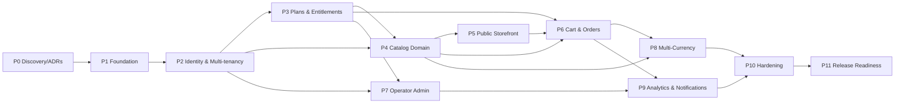

# PHASE 0 — Discovery & Architecture

> **Project:** `Catalogo+WA` — multi-tenant white-label catalog + WhatsApp ordering SaaS
> **Status:** Phase 0 deliverables — **DRAFT for Director approval**
> **Author:** Principal engineering team (analysis role)
> **Date:** 2026-08-21
> **Rule in force:** No product code and no Phase 1 work until Phase 0 is explicitly approved.

This document is the index and narrative of Phase 0. Deep-dives live in companion files:

| Deliverable | Location |
|---|---|
| Architecture decisions (ADRs) | [`docs/adr/`](./adr/) |
| Domain model | [`DOMAIN-MODEL.md`](./DOMAIN-MODEL.md) |
| Initial database design | [`DATABASE-DESIGN.md`](./DATABASE-DESIGN.md) |

---

## 1. Repository assessment

**Current state — greenfield.**

```
Catalogo-SaaS/
├── PLAN-DE-DESARROLLO.md   # business-level plan (v1.0, prior artifact)
└── docs/                    # (Phase 0 documents added here)
```

Findings:
- **Not a git repository yet.** No VCS history, no branch protection, no CI. → Git init + protections are **Phase 1**, not Phase 0.
- **No application code, no `package.json`, no Docker, no migrations, no tests.** Clean slate — no legacy to reconcile.
- **One prior artifact:** `PLAN-DE-DESARROLLO.md` — a *business/PM* plan. It is useful context but its **technical proposal (NestJS + Redis) conflicts with this directive** (see §3). This directive supersedes it for engineering decisions.
- **Toolchain present locally (verified):** Node 22.23, npm 10.9, **pnpm 10.33**, **Docker 29.7 + Compose v5.3**, git 2.53, gh 2.94. Modern and sufficient for the recommended stack.
- **Design-system reference exists** in a *separate* project (`Preventa 001` — the pre-sale calculator): Inter typography, indigo palette, Lucide icons. Reusable for the storefront/admin visual language; **not** part of this codebase.

**Conclusion:** nothing constrains us technically. We choose the architecture from first principles under the directive's rules.

---

## 2. Requirement assessment

Traceability of the directive's requirements to a build phase. `MVP` = required for first release.

| Area | Requirement (summary) | MVP? | Phase | Notes |
|---|---|---|---|---|
| Identity | Register, login, sessions, password recovery, email-verification *architecture*, RBAC | ✅ | P2 | Email *verification enforcement* optional; architecture wired. |
| Platform Owner | Manage/activate operators, system health visibility | ✅ | P2/P7 | Minimal owner console. |
| Operator | Manage businesses, plans, assign plans, branding (logo/colors/domain), global metrics | ✅ | P3/P7/P9 | Custom **domains** flagged — see §3. |
| Business | Catalogs, categories, products, images, stock, prices, base currency, WhatsApp number, orders, users | ✅ | P4/P6 | Advanced inventory **out of scope**. |
| Public catalog | SEO, responsive, fast, accessible, search, categories, product detail, cart, order form | ✅ | P5/P6 | Currency conversion arrives P8. |
| Order | Persist **before** WhatsApp redirect; **immutable snapshot** (name/price/currency/qty/customer/total); state machine | ✅ | P6 | Core correctness requirement. |
| WhatsApp | Safe, encoded `wa.me` URL; deterministic, testable message; store number/ref/timestamp/link-generated flag; **no delivery guarantee** | ✅ | P6 | Cloud API **out of scope**. |
| Multi-tenancy | No cross-tenant leakage; defense in depth; cross-tenant tests are release-blocking | ✅ | P2 | See [ADR-0002](./adr/ADR-0002-multi-tenancy.md). |
| Entitlements | Centralized limits/features; server-side enforcement; no hardcoded plan names | ✅ | P3 | See §10 module `entitlements`. |
| Money | Integer minor units; Money abstraction; historical rate handling | ✅ | P6/P8 | See [ADR-0003](./adr/ADR-0003-money-and-currency.md). |
| Multi-currency | Base currency, provider abstraction (BCV + others), caching, display conversion, visitor selection, historical policy | ✅ | P8 | Provider abstraction mandatory. |
| Images | Object storage; DB stores references; storage abstraction; MinIO dev | ✅ | P4 | See [ADR-0004](./adr/ADR-0004-image-storage.md). |
| Analytics | Business/product/order metrics; email architecture; Premium export | ✅(basic) | P9 | Derived from `orders`; no separate store. |
| Docker/Envs | dev/staging/prod, health checks, volumes, restart policies, reproducible | ✅ | P1/P10 | §11. |
| DB | Migrations, seeds, test DB, FKs, tenant-aware indexes, audit documented | ✅ | P1+ | §9 + DATABASE-DESIGN. |
| Testing | Unit/integration/e2e pyramid; green each phase | ✅ | P1+ | §13. |

**Coverage:** every directive requirement maps to a phase. No orphan requirements; no requirement forces early complexity.

---

## 3. Contradictions, ambiguities & decisions required

These need a **Director decision** before or during the relevant phase. Recommendations included.

| # | Item | Tension | Recommendation (awaiting approval) |
|---|---|---|---|
| **D1** | **Stack** | Prior `PLAN-DE-DESARROLLO.md` proposed **NestJS + Redis**; this directive mandates *modular monolith first*, *no Redis without demonstrated need*, *boring tech*, *MVP speed*, *small team*. | **Option A — Next.js modular monolith + Drizzle + PostgreSQL + Docker; defer Redis.** See [ADR-0001](./adr/ADR-0001-stack-and-architecture.md). |
| **D2** | **Tenant granularity** | Hierarchy Operator → Business. Which is *the* isolation boundary for RLS? | **Business is the primary data tenant** (`business_id`); operator-scoped data keyed by `operator_id`; both enforced via RLS. See [ADR-0002](./adr/ADR-0002-multi-tenancy.md). |
| **D3** | **Plan ownership** | Are plans global or per-operator? Directive: "Operator can create and manage plans." | **Plans are operator-scoped.** Each operator defines its own Basic/Medium/Premium. |
| **D4** | **Custom domains in MVP** | Premium lists "custom domains"; per-tenant domains + TLS + routing add real ops complexity. | **MVP = subdomain routing** (`business.operator-domain`). Custom domains modeled as an **entitlement flag but deferred** to P7+/post-MVP. Confirm. |
| **D5** | **Usage counter reset** | "Orders per month" needs a defined boundary. | **Calendar month (UTC)** for MVP; revisit per-subscription anniversary later. Confirm. |
| **D6** | **Email verification** | "Architecture" vs enforced gate. | **Architecture wired (tokens, templates), enforcement OFF for MVP** (operators onboard businesses manually). Confirm. |
| **D7** | **Product detail** | "Product pages **or** details". | **Dedicated product route** (`/{business}/p/{slug}`) for SEO; cheap to build, better indexing. |
| **D8** | **Auth mechanism** | Sessions vs JWT; directive says "secure sessions". | **Server-side sessions (httpOnly cookie, DB-backed)** — simpler CSRF/rotation story than JWT, no Redis needed. See ADR-0001. |
| **D9** | **Brand/name** | `Catalogo+WA` is a codename. | Placeholder until operator branding is set in P7; no code depends on the name. |

> **None of these block starting Phase 1** except **D1 (stack)**, which is the one decision I need approved to proceed.

---

## 4. Architecture alternatives (evaluation)

Full analysis in [ADR-0001](./adr/ADR-0001-stack-and-architecture.md). Summary scoring (1 = poor, 5 = excellent) against the directive's own criteria:

| Criterion | A · Next.js + Drizzle (modular monolith) | B · Next.js + NestJS + Redis (2 apps) | C · Monorepo, independently deployable FE/BE |
|---|:--:|:--:|:--:|
| Development complexity | **5** | 3 | 2 |
| Operational complexity | **5** | 3 | 2 |
| Cost (≤ $75/mo target) | **5** | 3 | 2 |
| MVP delivery speed | **5** | 3 | 2 |
| Security | 4 | 4 | 4 |
| Testability | 4 | **5** | **5** |
| SEO (public catalog) | **5** | 4 | 4 |
| Multi-tenancy fit | 4 | 4 | 4 |
| Future scalability | 3 | 4 | **5** |
| Team size fit (small) | **5** | 3 | 2 |
| Long-term maintenance | 4 | 4 | 3 |
| **Weighted verdict (MVP-oriented)** | **RECOMMENDED** | Over-built for now | Premature |

**Rationale:** Options B and C buy *independent scalability* and *stronger service boundaries* at the cost of two deploy targets, more infra (incl. Redis), and slower MVP — none justified by a **demonstrated** requirement at current scale (tens of businesses, thousands of orders/month, one small team, ≤$75/mo infra). Option A delivers the same correctness guarantees (transactions, RLS, entitlements, immutable snapshots) with far less operational surface, and preserves an upgrade path (extract a module to a service later behind its existing contract).

---

## 5. Recommended stack (proposed)

| Concern | Choice | Why (demonstrated need) |
|---|---|---|
| Runtime | **Node.js 22 (LTS)** | Present; broad ecosystem. |
| Language | **TypeScript (strict, no `any`)** | Directive mandates typing; catches money/tenant bugs. |
| App framework | **Next.js (App Router)** — full-stack | One deployable; SSR/SSG for SEO storefront; route handlers + server actions for API. |
| Package manager | **pnpm 10** | Fast, disk-efficient, workspace-ready if we split later. |
| ORM / migrations | **Drizzle ORM + drizzle-kit** | SQL-first, fully typed, explicit migrations, **supports raw SQL for RLS/`SET LOCAL`** which we need. |
| Database | **PostgreSQL 16** | Relational integrity, **Row-Level Security**, transactions. |
| Cache/queue | **None in MVP (deferred)** | No demonstrated need; exchange-rate cache = DB table w/ TTL; rate-limit = Postgres/in-proc. *Trigger to add Redis documented in ADR-0001.* |
| Object storage | **S3-compatible (Cloudflare R2 / Backblaze) + MinIO for dev** | Cheap image storage; DB holds references. [ADR-0004]. |
| Validation | **Zod** | Runtime input validation + env validation + shared types. |
| Auth | **Server-side sessions (DB-backed, httpOnly cookies)** + **argon2** hashing | Secure, no Redis, easy rotation/revocation. |
| Reverse proxy/TLS | **Caddy** (auto-HTTPS) | Simple per-domain TLS; fewer moving parts than manual Nginx+certbot. |
| Testing | **Vitest** (unit/integration) + **Playwright** (e2e) + **Testcontainers** (ephemeral Postgres) | Fast unit, real-DB integration, real-browser e2e. |
| CI | **GitHub Actions** | Free tier, matches `gh` availability. |
| Containerization | **Docker + Compose (v2/v5) with overrides** | Reproducible dev/staging/prod. |
| Observability | **pino** structured logs + healthchecks + error tracking (Sentry free tier) | Ops visibility from day one. |

> This is a **proposal**. Approving [ADR-0001](./adr/ADR-0001-stack-and-architecture.md) ratifies it.

---

## 6. ADR index

All ADRs are **Accepted (Director approved 2026-08-21)**. Located in [`docs/adr/`](./adr/).

| ADR | Title | Decision (proposed) |
|---|---|---|
| [0001](./adr/ADR-0001-stack-and-architecture.md) | Stack & application architecture | Next.js modular monolith + Drizzle + PostgreSQL + Docker; Redis deferred. |
| [0002](./adr/ADR-0002-multi-tenancy.md) | Multi-tenancy isolation | **Option D**: app-level tenant scoping **+** PostgreSQL RLS (defense in depth). |
| [0003](./adr/ADR-0003-money-and-currency.md) | Money & currency representation | Integer minor units + `Money` value object; historical rate snapshots. |
| [0004](./adr/ADR-0004-image-storage.md) | Image storage | Object storage via a `Storage` port; MinIO dev / R2 prod; DB stores references. |

Future ADRs anticipated (not yet needed): `0005` entitlement model details, `0006` auth/session strategy hardening, `0007` background jobs (if/when Redis is justified).

---

## 7. Domain model

Full model — entities, value objects, aggregates, ownership, lifecycle states, invariants, state transitions — in **[DOMAIN-MODEL.md](./DOMAIN-MODEL.md)**.

Headline aggregates: `Operator`, `Business`, `Subscription`, `Catalog`, `Product`, `Order`.
Headline invariants (excerpt): a product cannot belong to another business's catalog; an order snapshot is immutable; an inactive business serves no public catalog; a suspended operator serves no public catalogs; usage cannot exceed plan limits; a plan change never corrupts current usage.

---

## 8. Multi-tenancy design

Full design + threat cases in **[ADR-0002](./adr/ADR-0002-multi-tenancy.md)**. Summary:

- **Boundary:** `business_id` for business data; `operator_id` for operator data.
- **Defense in depth:** (1) authenticated **tenant context** resolved server-side (never from client); (2) a **tenant-scoped data-access layer** that injects the tenant filter; (3) **PostgreSQL RLS** as the backstop — every business table has an RLS policy keyed to a session variable (`app.current_business` / `app.current_operator`) set via `SET LOCAL` inside each request transaction.
- **Never** trust client-provided tenant IDs, roles, prices, or plan permissions.
- **Release-blocking tests:** an automated suite that authenticates as tenant A and *attempts* to read/write tenant B's rows through every protected path; any success fails CI.

---

## 9. Initial database design

Full schema, keys, RLS policies, and index justifications in **[DATABASE-DESIGN.md](./DATABASE-DESIGN.md)**. Principles:

- Explicit **migrations** only (drizzle-kit); no ad-hoc schema drift.
- Every business-owned table carries `business_id` (and `operator_id` where useful) with FKs and RLS.
- **Indexes justified by query pattern** (no speculative indexes) — e.g., `(business_id, catalog_id)` for product listing, `(business_id, created_at)` for order history.
- Money stored as **`bigint` minor units + `currency` char(3)** (never `float`).
- Order lines store an **immutable snapshot** (name, unit price, currency, qty) independent of live product rows.
- **Soft delete only where justified** (products/catalogs to preserve order history integrity); hard delete elsewhere.

---

## 10. Module boundaries (modular monolith)

One deployable, explicit internal modules with contracts (no cross-module reaching into another's tables):

```
src/modules/
├── identity/         # users, auth, sessions, RBAC, password reset, email-verify arch
├── operators/        # operator lifecycle, activation/suspension, branding
├── businesses/       # business lifecycle, WhatsApp number, base currency
├── memberships/      # user↔business/operator roles
├── plans/            # plan definitions (operator-scoped)
├── entitlements/     # centralized limits/features + usage; canX(business) API
├── catalogs/
├── categories/
├── products/
├── media/            # storage port + image pipeline (validate, resize, reference)
├── orders/           # cart→order, snapshot, state machine, transactional persistence
├── whatsapp/         # deterministic wa.me message + URL builder (pure, testable)
├── currencies/       # Money VO, currency metadata, precision/rounding
├── exchange-rates/   # provider port (BCV + others), cache, historical policy
├── analytics/        # read-model queries over orders
├── notifications/    # email architecture
└── platform-admin/   # owner console, operator management, health
```

Rules (enforced by lint boundaries + review):
- A module exposes a **public contract** (types + service functions); others import only that.
- **No generic `services/` dumping ground.** No circular deps (enforced via `eslint-plugin-boundaries` / `dependency-cruiser`).
- `entitlements` is consumed by write paths in `catalogs/products/orders/memberships` — it is the *single* place plan limits live.

---

## 11. Docker strategy

- `docker-compose.yml` (base) + `docker-compose.override.yml` (dev) + `docker-compose.prod.yml`.
- **Dev services:** app (Next.js, hot reload), `postgres:16`, `minio` (S3 dev), `mailpit` (email capture). No Redis.
- **Prod:** app image (multi-stage build, non-root user), Postgres (managed or container w/ persistent volume), Caddy (TLS/proxy). **Healthchecks**, **named volumes**, **`restart: unless-stopped`**.
- **Env:** `.env.example` committed; real secrets **never** committed; **Zod-validated env** at boot (fail fast on missing/invalid).
- Different configs per environment (no shared unsafe defaults); documented **startup & recovery** runbook (Phase 1/11).

---

## 12. CI/CD strategy

- **CI (every PR):** install (pnpm, cached) → lint → typecheck → unit tests → integration tests (Testcontainers Postgres) → build. Plus dependency audit + secret scan. **All must be green.**
- **Branch protection:** `main` and `develop` protected; PR + green CI + review required; no direct pushes.
- **CD:** merge to `develop` → deploy **staging** (runs migrations); tag `vX.Y.Z` on `main` → deploy **prod** with gated migration step + documented **rollback**.
- **e2e (Playwright):** run on PRs touching storefront/order paths and nightly on staging.

---

## 13. Testing strategy

Pyramid (see §15 of `PLAN-DE-DESARROLLO.md` for narrative; this refines it):

- **Unit (fast, no I/O):** Money math, currency conversion, entitlement evaluation, order total calc, **`wa.me` message/URL generation (deterministic)**, domain invariants.
- **Integration (real Postgres via Testcontainers):** persistence, auth, **tenant isolation**, plan-limit enforcement, transactional order creation (incl. failure → no WhatsApp URL).
- **e2e (Playwright):** the critical journey *operator→business→catalog→products→publish→customer→cart→order persisted→wa.me URL*.
- **Security tests (release-blocking):** cross-tenant access attempts (§8).
- **Rule:** each phase ends **green**; coverage never lowered to pass CI; failing tests are never disabled.

---

## 14. Security risks (initial threat analysis)

STRIDE-flavored, focused on this system:

| Risk | Vector | Severity | Mitigation (phase) |
|---|---|---|---|
| **Cross-tenant data leakage** | Missing/incorrect tenant filter | **Critical / release-blocking** | Defense-in-depth (ADR-0002); automated cross-tenant tests (P2). |
| Price/total tampering | Client submits prices/totals | High | Server recomputes from DB; snapshot server-side; ignore client money (P6). |
| Privilege escalation | Client-supplied role/plan | High | Server is authz source of truth; RBAC checks server-side (P2/P3). |
| Broken auth | Weak hashing/session | High | argon2, httpOnly DB-backed sessions, rotation, rate-limit login (P2). |
| Malicious file upload | Fake/oversized images, SVG XSS | High | MIME allow-list (jpeg/png/webp), size caps, re-encode/strip metadata, no SVG (P4/ADR-0004). |
| Injection (SQL/XSS) | Unsanitized input/output | High | Parameterized queries (Drizzle), Zod validation, output encoding, CSP (P1+). |
| Public endpoint abuse | Order/catalog scraping/spam | Medium | Rate limiting, minimal PII, bot friction on order form (P5/P6). |
| Secret leakage | Secrets in repo/logs | High | Secrets outside repo, `.env` ignored, log redaction (P1). |
| PII handling | Customer name/phone in orders | Medium | Data minimization, retention policy, access controls, audit log (P6/P10). |
| Suspended-operator bypass | Public catalog served while suspended | Medium | Status check in public routing + RLS predicate (P2/P5). |

---

## 15. Proposed sprint backlog (Phase-0 exit → Phase 1)

Sprints = 1 week. **This backlog covers only P0 closure and P1**; later phases expand after approval.

**P0 (this deliverable) — remaining to "approved":**
- [ ] Director reviews ADR-0001..0004, DOMAIN-MODEL, DATABASE-DESIGN.
- [ ] Director resolves decisions **D1–D9** (§3).
- [ ] Approval to start Phase 1.

**P1 — Foundation (proposed once approved):**
- [ ] `chore:` git init, branch model, protections, conventional-commits, changelog.
- [ ] `chore:` pnpm workspace, Next.js app skeleton, **strict** tsconfig, ESLint (+ boundary rules), Prettier.
- [ ] `feat:` Zod-validated env loader; `.env.example`.
- [ ] `feat:` Docker Compose dev (app + postgres + minio + mailpit) with healthchecks.
- [ ] `feat:` Drizzle setup + first migration (empty baseline) + seed scaffold.
- [ ] `test:` Vitest + Testcontainers harness; Playwright bootstrap; 1 smoke test per layer.
- [ ] `ci:` GitHub Actions pipeline (lint/typecheck/test/build) green on an empty app.
- [ ] `docs:` `README` (run/recover), `ARCHITECTURE.md`, module skeleton per §10.
- **Exit:** empty but production-grade foundation; CI green; app boots in Docker; **no product features**.

---

## 16. Phase dependency map



Hard dependencies:
- **P2 gates everything** (tenant context underpins all data access; entitlements and catalog writes need it).
- **P3 (entitlements) before/with P4 & P6** so limits are enforced at creation of catalogs/products/orders.
- **P5 storefront** needs P4 data but shows **base currency only** until **P8** adds conversion.
- **P6 orders** depend on P4 (products) + P3 (order-per-month limit) + P5 (cart UI).
- **P8 currency** is deliberately late: storefront and orders work in base currency first; conversion is additive and must not rewrite historical snapshots.

---

## Approval gate — RESOLVED

**Phase 0 approved by the Director on 2026-08-21.**

Decision log:
- **ADR-0001** (stack: Next.js modular monolith + Drizzle + PostgreSQL + Docker, Redis deferred) — **Accepted**.
- **ADR-0002** (multi-tenancy: Option D, defense in depth) — **Accepted**.
- **ADR-0003** (money: integer minor units + Money VO) — **Accepted**.
- **ADR-0004** (image storage: object storage behind a port) — **Accepted**.
- **D1** stack → resolved via ADR-0001. **D2** tenant boundary → resolved via ADR-0002.
- **D3** plans operator-scoped — **confirmed**. **D4** custom domains deferred (subdomains MVP) — **confirmed**.
  **D5** monthly counter = calendar month UTC — **confirmed**. **D6** email-verify enforcement OFF (architecture wired) — **confirmed**.
  **D7** dedicated SEO product route — **confirmed**. **D8** DB-backed sessions — **confirmed**. **D9** codename placeholder — **confirmed**.

**Next:** produce the **Phase 1 plan** ([`PHASE-1-PLAN.md`](./PHASE-1-PLAN.md)) and gate on approval before implementing the foundation.
